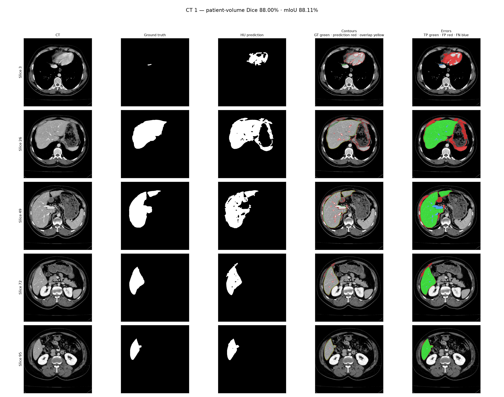
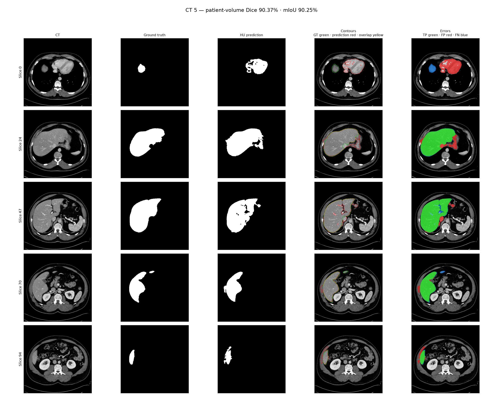
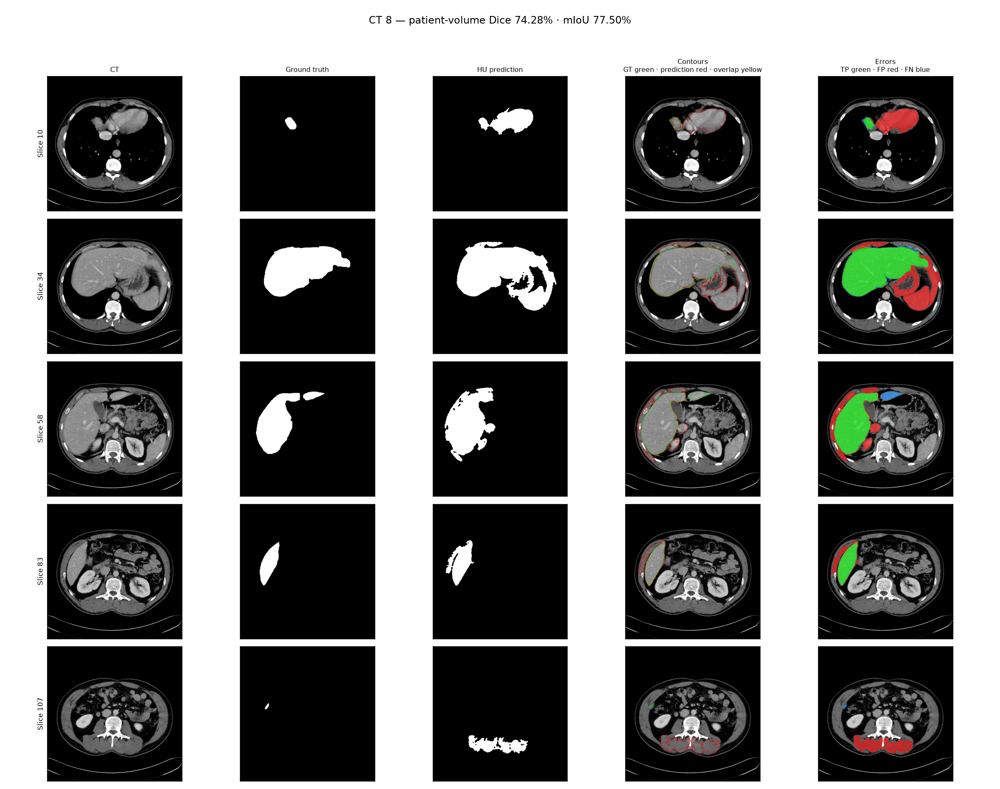
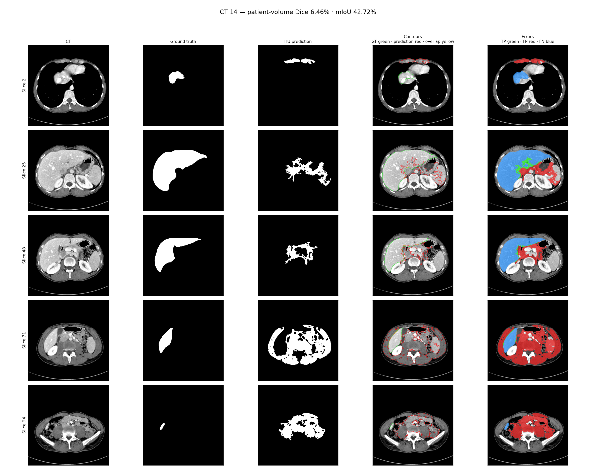
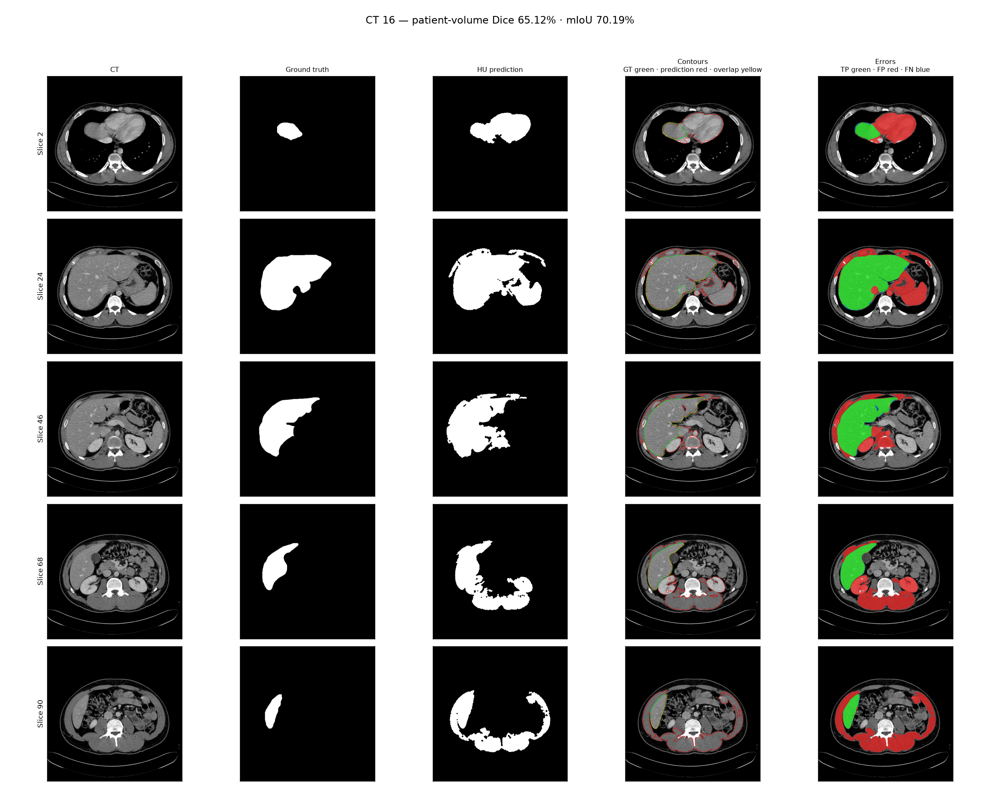
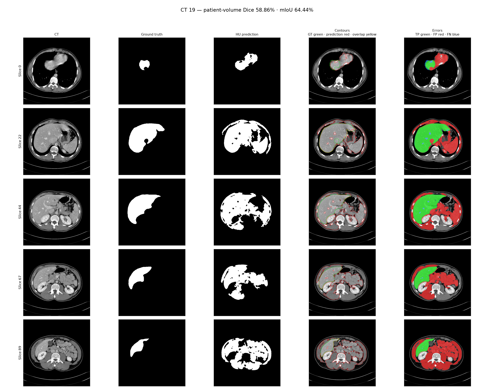
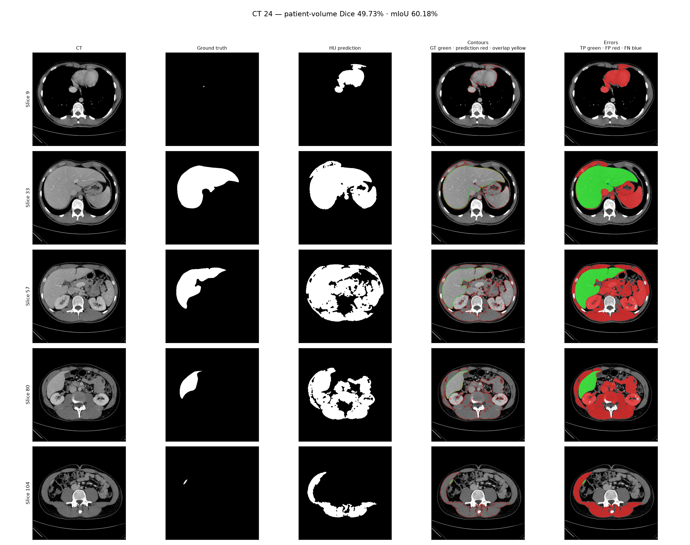
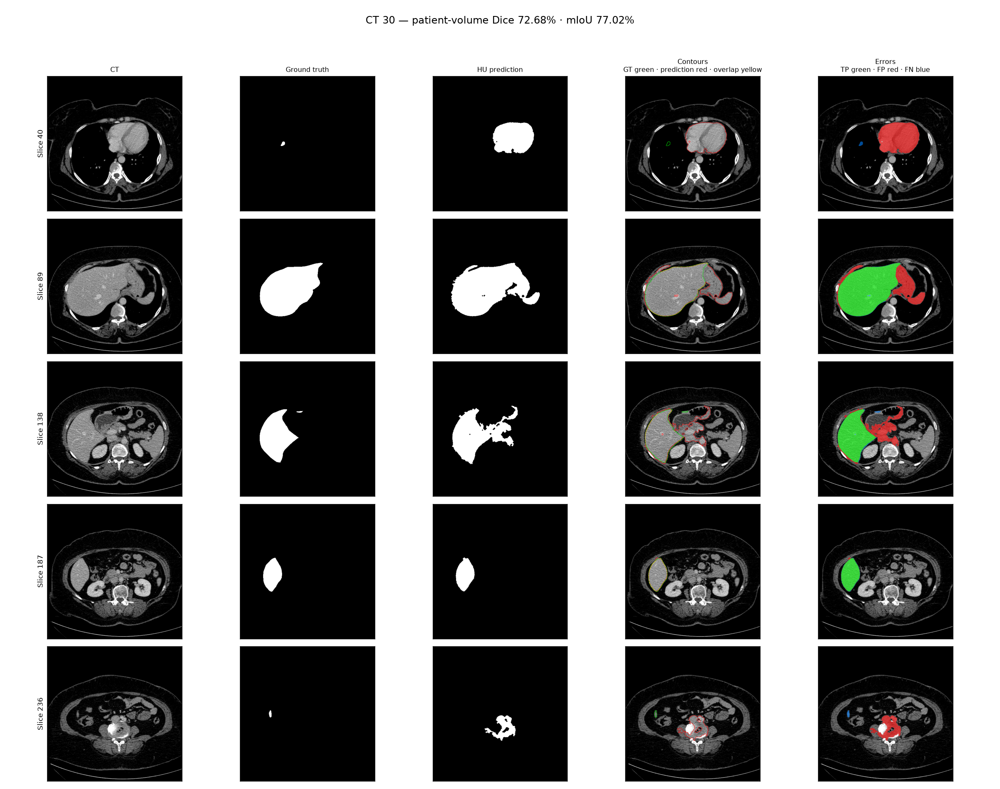

# CHAOS CT Visualization Gallery

**15 example patients · 20-patient evaluation · 2,874 slices**

Open this page in GitHub to browse the overlays inline. Select a patient link below to jump to its image. Each image compares CT, ground truth, prediction, aligned contours, and pixel-wise errors.

## Jump to a patient

| Patient | Dice | mIoU | Overlay |
|---:|---:|---:|---|
| 1 | 88.00% | 88.11% | [View image](cases/CT_1_comparison.png) |
| 2 | 92.16% | 92.26% | [View image](cases/CT_2_comparison.png) |
| 5 | 90.37% | 90.25% | [View image](cases/CT_5_comparison.png) |
| 6 | 70.61% | 72.38% | [View image](cases/CT_6_comparison.png) |
| 8 | 74.28% | 77.50% | [View image](cases/CT_8_comparison.png) |
| 14 | 6.46% | 42.72% | [View image](cases/CT_14_comparison.png) |
| 16 | 65.12% | 70.19% | [View image](cases/CT_16_comparison.png) |
| 18 | 87.04% | 87.24% | [View image](cases/CT_18_comparison.png) |
| 19 | 58.86% | 64.44% | [View image](cases/CT_19_comparison.png) |
| 22 | 83.33% | 84.45% | [View image](cases/CT_22_comparison.png) |
| 23 | 61.27% | 68.58% | [View image](cases/CT_23_comparison.png) |
| 24 | 49.73% | 60.18% | [View image](cases/CT_24_comparison.png) |
| 25 | 80.87% | 82.43% | [View image](cases/CT_25_comparison.png) |
| 26 | 79.37% | 81.14% | [View image](cases/CT_26_comparison.png) |
| 30 | 72.68% | 77.02% | [View image](cases/CT_30_comparison.png) |

## Overlays

Green marks correctly predicted liver, red marks false positives, blue marks missed liver. In the contour panel, yellow marks coincident ground-truth and prediction boundaries. Display window: −100 to 300 HU. These are display images; scoring uses the original CT values.

### Patient 1 · Dice 88.00% · mIoU 88.11%

### Patient 2 · Dice 92.16% · mIoU 92.26%

### Patient 5 · Dice 90.37% · mIoU 90.25%

### Patient 6 · Dice 70.61% · mIoU 72.38%

### Patient 8 · Dice 74.28% · mIoU 77.50%

### Patient 14 · Dice 6.46% · mIoU 42.72%

### Patient 16 · Dice 65.12% · mIoU 70.19%

### Patient 18 · Dice 87.04% · mIoU 87.24%

### Patient 19 · Dice 58.86% · mIoU 64.44%

### Patient 22 · Dice 83.33% · mIoU 84.45%

### Patient 23 · Dice 61.27% · mIoU 68.58%

### Patient 24 · Dice 49.73% · mIoU 60.18%

### Patient 25 · Dice 80.87% · mIoU 82.43%

### Patient 26 · Dice 79.37% · mIoU 81.14%

### Patient 30 · Dice 72.68% · mIoU 77.02%

## Full evaluation tables

- [Per-patient evaluation matrix](per_patient.csv): 20 patients, whole-volume counts and metrics.
- [Per-slice evaluation matrix](per_slice.csv): all 2,874 slices.
- [Summary and aggregation definitions](summary.json): patient mean, slice mean, pooled scores and conventions.
- [Original curated bundle guide](../visualization/github/README.md): selection method, full artifact inventory, dataset attribution and license notes.

Examples are selected at evenly spaced ranks after sorting the cohort by whole-volume Dice. The gallery shows examples across the measured range; evaluation includes all 20 patients.
