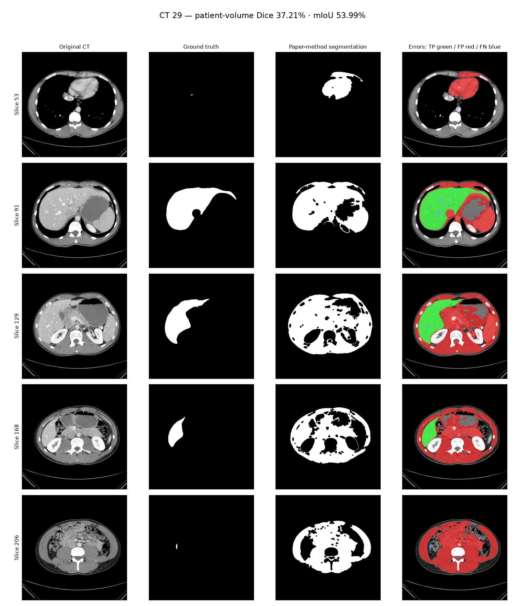
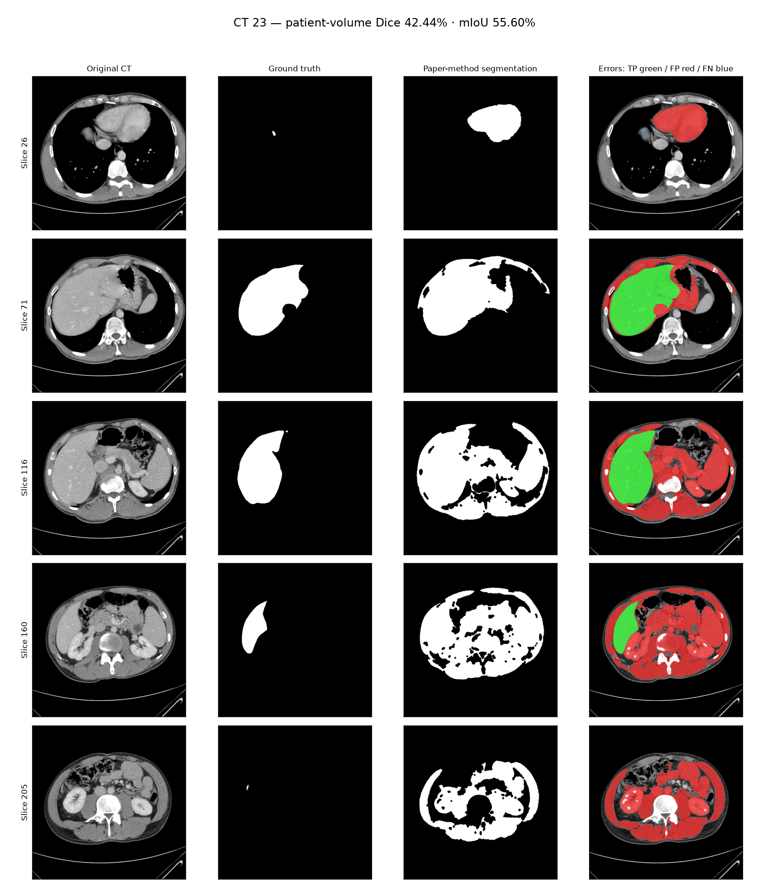
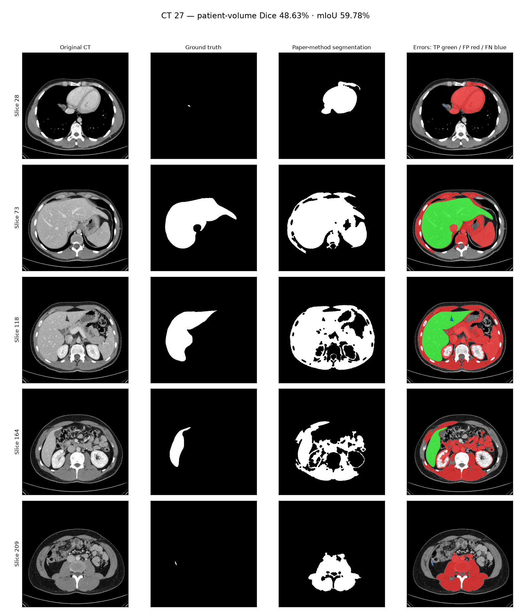
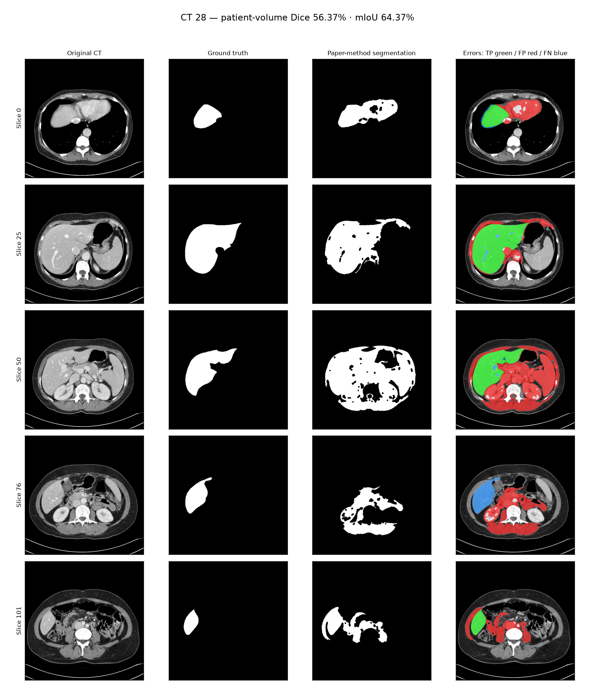
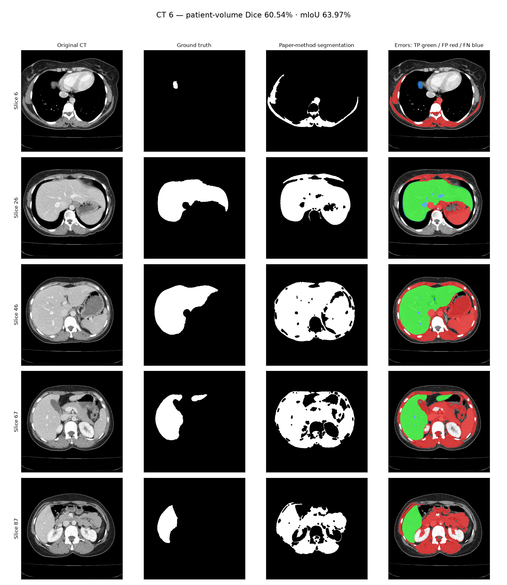
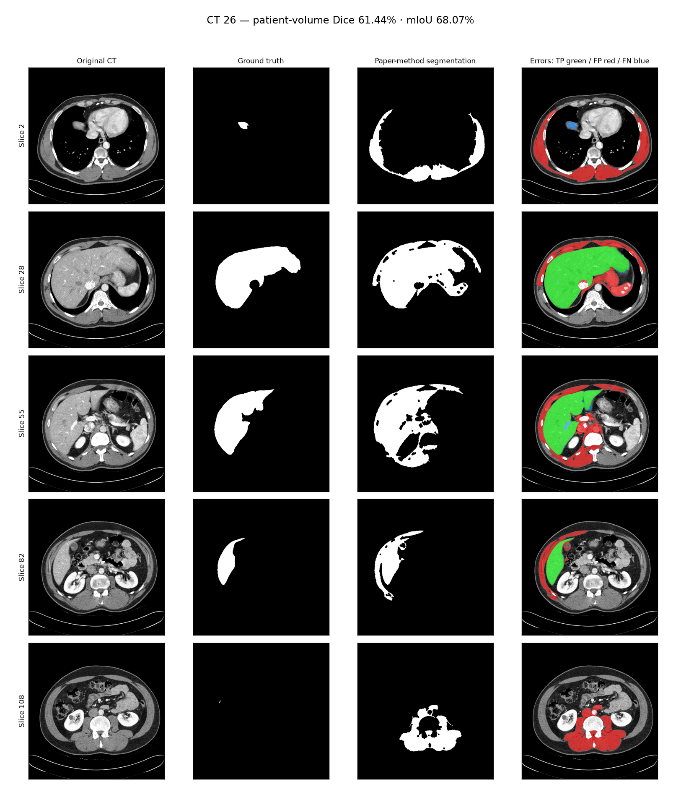
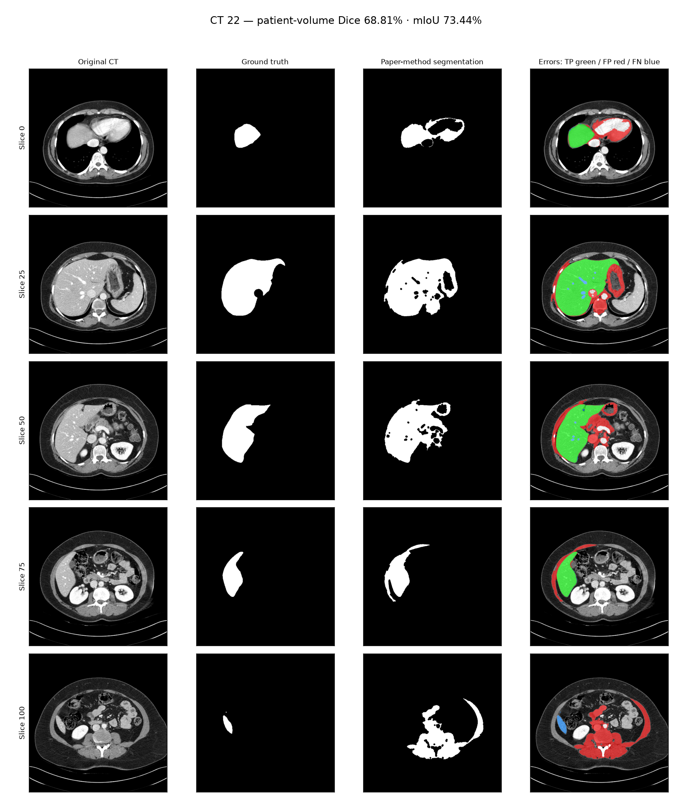
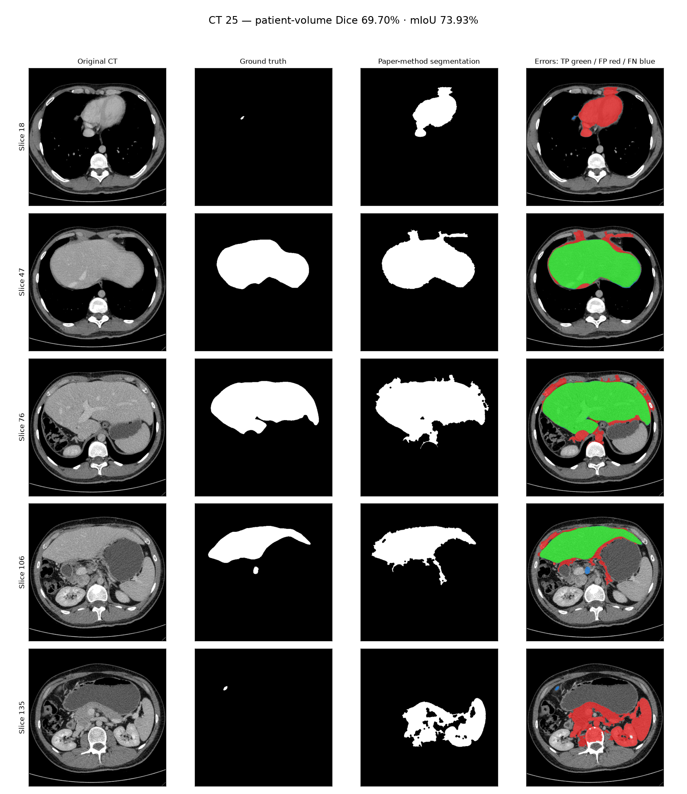
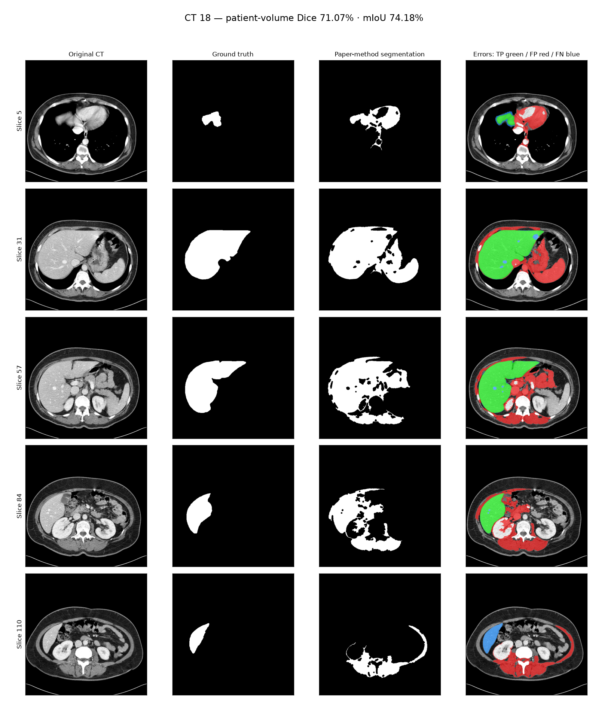
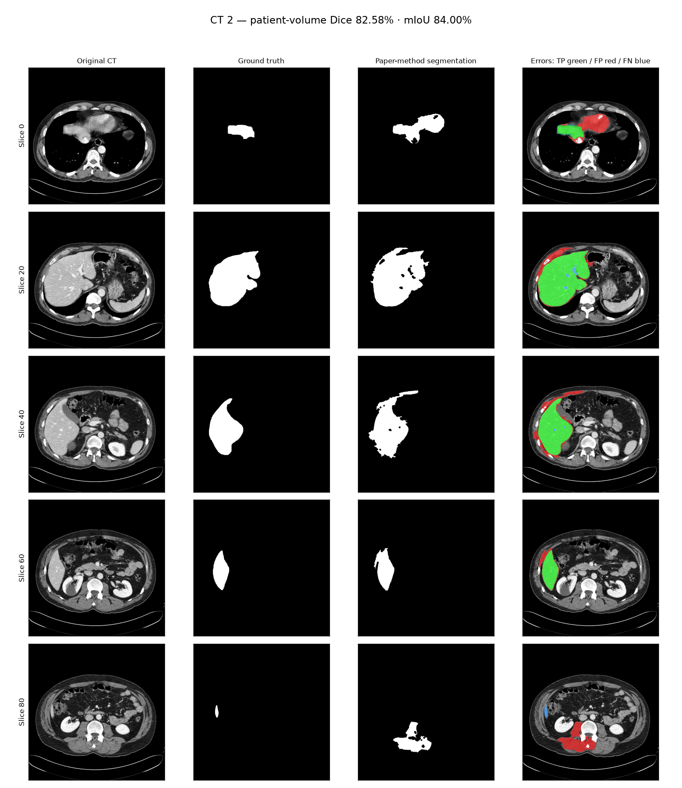

# CHAOS CT Visualization Gallery

**15 example patients · 20-patient evaluation · 2,874 slices**

Open this page in GitHub to browse the overlays inline. Each image compares CT, ground truth, prediction, aligned contours, and pixel-wise errors.

## Jump to a patient

| Patient | Dice | Liver IoU | Background IoU | mIoU | Overlay |
|---:|---:|---:|---:|---:|---|
| 14 | 4.10% | 2.09% | 75.00% | 38.54% | [View image](cases/CT_14_comparison.png) |
| 29 | 37.21% | 22.86% | 85.13% | 53.99% | [View image](cases/CT_29_comparison.png) |
| 23 | 42.44% | 26.93% | 84.27% | 55.60% | [View image](cases/CT_23_comparison.png) |
| 27 | 48.63% | 32.13% | 87.44% | 59.78% | [View image](cases/CT_27_comparison.png) |
| 19 | 49.86% | 33.20% | 81.92% | 57.56% | [View image](cases/CT_19_comparison.png) |
| 8 | 54.44% | 37.40% | 90.15% | 63.77% | [View image](cases/CT_8_comparison.png) |
| 28 | 56.37% | 39.25% | 89.50% | 64.37% | [View image](cases/CT_28_comparison.png) |
| 6 | 60.54% | 43.41% | 84.54% | 63.97% | [View image](cases/CT_6_comparison.png) |
| 26 | 61.44% | 44.34% | 91.79% | 68.07% | [View image](cases/CT_26_comparison.png) |
| 1 | 62.51% | 45.47% | 90.45% | 67.96% | [View image](cases/CT_1_comparison.png) |
| 22 | 68.81% | 52.45% | 94.43% | 73.44% | [View image](cases/CT_22_comparison.png) |
| 25 | 69.70% | 53.49% | 94.36% | 73.93% | [View image](cases/CT_25_comparison.png) |
| 18 | 71.07% | 55.13% | 93.23% | 74.18% | [View image](cases/CT_18_comparison.png) |
| 5 | 79.17% | 65.52% | 95.31% | 80.42% | [View image](cases/CT_5_comparison.png) |
| 2 | 82.58% | 70.32% | 97.68% | 84.00% | [View image](cases/CT_2_comparison.png) |

## Overlays

Green marks correctly predicted liver, red marks false positives, and blue marks missed liver. In the contour panel, yellow marks coincident ground-truth and prediction boundaries. Display window: −100 to 300 HU. These are display images; scoring uses the original CT values.

### Patient 14 · Dice 4.10% · mIoU 38.54%

### Patient 29 · Dice 37.21% · mIoU 53.99%

### Patient 23 · Dice 42.44% · mIoU 55.60%

### Patient 27 · Dice 48.63% · mIoU 59.78%

### Patient 19 · Dice 49.86% · mIoU 57.56%

### Patient 8 · Dice 54.44% · mIoU 63.77%

### Patient 28 · Dice 56.37% · mIoU 64.37%

### Patient 6 · Dice 60.54% · mIoU 63.97%

### Patient 26 · Dice 61.44% · mIoU 68.07%

### Patient 1 · Dice 62.51% · mIoU 67.96%

### Patient 22 · Dice 68.81% · mIoU 73.44%

### Patient 25 · Dice 69.70% · mIoU 73.93%

### Patient 18 · Dice 71.07% · mIoU 74.18%

### Patient 5 · Dice 79.17% · mIoU 80.42%

### Patient 2 · Dice 82.58% · mIoU 84.00%

## Full evaluation tables

- [Per-patient evaluation matrix](per_patient.csv): 20 patients, whole-volume counts and metrics.
- [Per-slice evaluation matrix](per_slice.csv): all 2,874 slices.
- [Summary and aggregation definitions](summary.json): patient mean, slice mean, pooled scores and conventions.
- [Original curated bundle guide](../visualization/github/README.md): selection method, full artifact inventory, dataset attribution and license notes.

Examples are selected at evenly spaced ranks after sorting the cohort by whole-volume Dice. The gallery shows examples across the measured range; evaluation includes all 20 patients.
